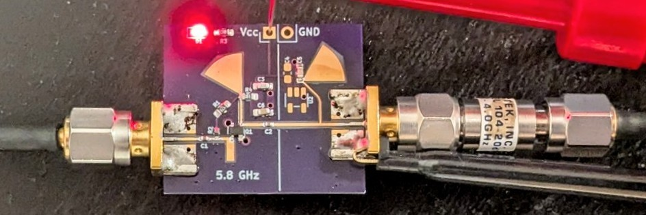
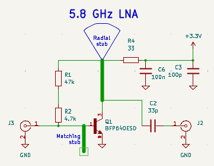
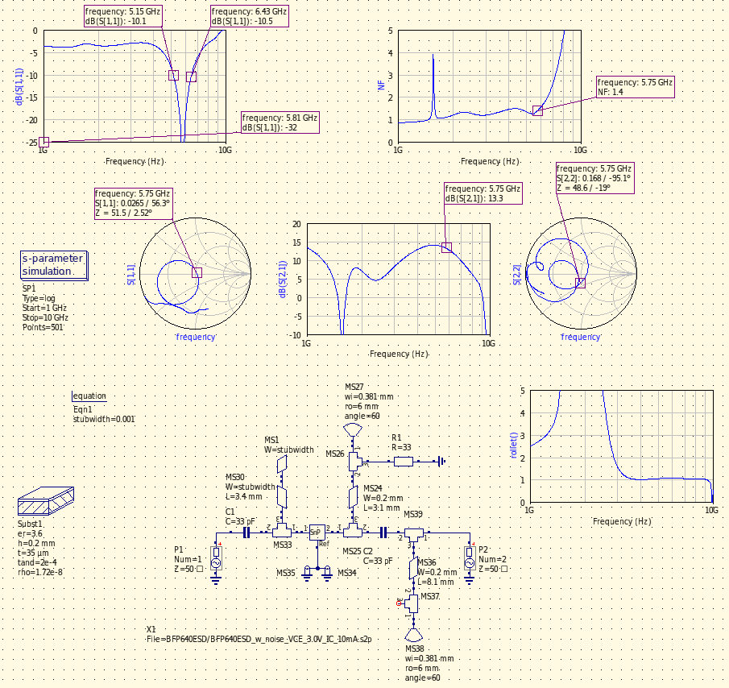

## Low Noise Amplifier for 5.8 GHz

### Design

The design was created around the BFP640ESD SiGe BJT transistor; this device has an ft of ~46 GHz, and consequently low noise figure at the intended 5.8 GHz ISM band. The 4-layer service from OSHpark was chosen as the target stackup. The small-signal S-parameters of the transistor are published by the manufacturer (up to 10 GHz), which enables optimizing the circuit within [simulation environment](https://qucsstudio.de/), before building:

The amplifier is unstable at low frequencies when the upper part of the load stub is fully RF grounded, therefore grounding is achieved in two steps: first, a radial stub creates an RF ground for 5.8 GHz, then the low-frequency grounding of the entire circuit is done with high-value capacitors behind a 33 Ω resistor. This resistor acts as a damper ("lossy ground") for the lower frequencies, hence the amplifier becomes stable. The 33 Ω resistor also serves as the load for auto-biasing.

### Performance

Gain is 11.5 dB, S11 is broad band and satisfactory. Power supply requiremens are +3.3V and 10mA; RF performance parameters remain mostly unchanged between 2.7V and 4V power supply voltages.

S-parameter (DIY [VNA](https://github.com/szoftveres/RF_instruments/tree/main/vna)) measurement:

