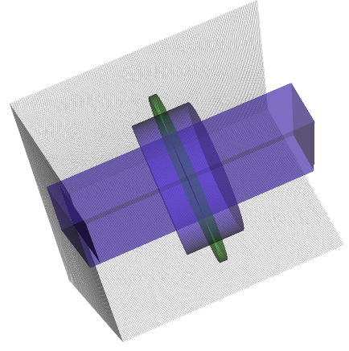
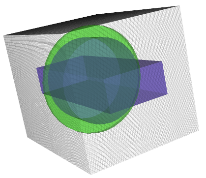
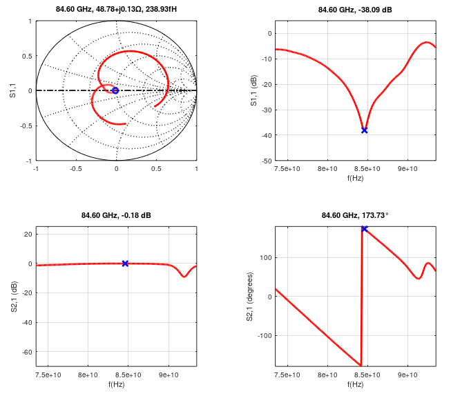

## Pillbox Vacuum Window, 81-86 GHz, WR12 waveguide

[OpenEMS script](pillbox.m)

After determining the window material and stock to be used (10 mil thick Alumina in this case), the most important dimension to find is the length of the circular waveguide, which contains exactly 3/4λ of the guided wave at center frequency, including the wave portion traveling inside the window. Due to the window being made of material that has higher dielectric constant than air (or vacuum) and the wavelength being physically shorter in it, the overall cavity is slightly shorter than 3/4λ.

Ideally, the metal surrounding the window rim should form a dielectric 1/4λ choke, however due to practical (mounting and durability) reasons this choked is sized to 3/4λ, allowing more window material to be embedded into the metal frame.

