# High Performance Microstrip Patch Antennas for 5.8 GHz

Designed around OSHpark's 4-layer service.

## Basic Patch Antenna

The design starts with a regular microstrip patch, with its length selected to be resonant at the band center frequency. The width of the patch influences the gain as well as the apparent feedpoint impedance at a given coupling; the wider the patch, the more the directivity (gain), because the two in-phase ends of the spreading fringing fields along the long edge of the patch start behaving like an array instead of a point-source, focusing the beam, as well as due to simply the larger aperture. A wider patch also results in lower feedpoint impedance (for a given coupling) as well as slightly more bandwidth. If circular-polarization is not a requirement, selecting the width to be slightly different from the length is advantageous, because it reduces the risk of cross-polarization. The beamforming effect on the longitudinal axis is due the patch antenna being equivalent to essentially two in-phase aperture antennas (the aperture is formed between the edges and the ground plane). The end result is a relatively high gain antenna with well-defined directivity.

## Aperture Coupling

Coupling is done to the antenna from the feed line microstrip via an aperture on the ground plane, embedded inside the antenna PCB (aperture-coupling is described [here](https://ptacts.uspto.gov/ptacts/public-informations/petitions/1525304/download-documents?artifactId=d23MfW1fvKR4pzkGUmERh8ZxrJW7turGkfuFS_fFzEMN9wEr-BOYOZo) and [here](https://people.umass.edu/dpozar/miscfiles/aperture.pdf)). This coupling method allows the feed line to be laid out on the back side of the antenna and doesn't require vias; also the feed line is galvanically isolated from the antenna element.

The size (length) of the aperture determines the coupling and consequently the feedpoint impedance. Due to this extra independent feedpoint impedance adjustability, there's some freedom with regard to selecting the width of the patch; A slightly wide (more focused beam, as well as to prevent cross-polarization) but mostly square design is a good starting point; in this case, the W:L ratio is 1.125.

The microstrip feed line crosses the aperture in the middle, and ends in a λ/4 open stub, with its low-impedance point being right over the aperture (any extra unwanted reactances can be tuned out by slightly changing the length of the stub in either way, as necessary).

[OpenEMS](https://www.openems.de/) simulation:

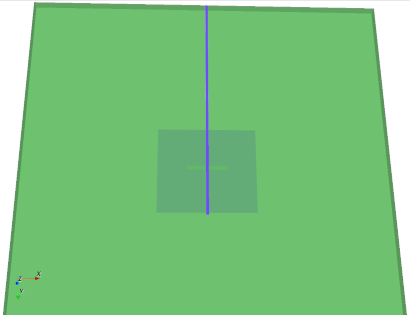

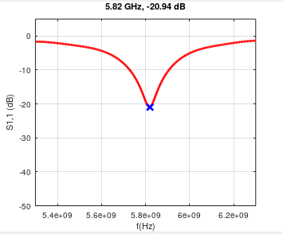

The result (as expected from a regular, simple patch antenna) is very narrow-band performance, barely sufficient to cover the ~ 200 MHz bandwidth of the 5.8 GHz ISM band.

An example was built and measured (with my [DIY VNA](https://github.com/szoftveres/RF_instruments/tree/main/vna)):

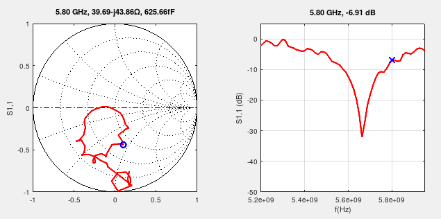  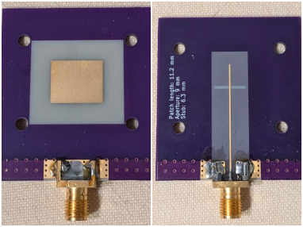

The result is narrow-band performance as well as complete uselessness, due to a slight (~1.7%) shift in center frequency, moving the antenna completely out of band. The frequency shift was mostly due to my mistake (forgot to remove a 0.1 mm copper rim around the patch in KiCad). Nevertheless, the design clearly demonstrates its weak point, which is very narrow band and tight tolerance.

## Stacking

Tight-coupling a resonant element (with close or identical resonant frequency) to a patch antenna can broaden its bandwidth; in this case a PCB with a patch of identical dimensions on it was suspended above the existing antenna. After re-tuning and optimizing the coupling aperture (due to changing impedance conditions), an antenna with more broadband performance emerged:

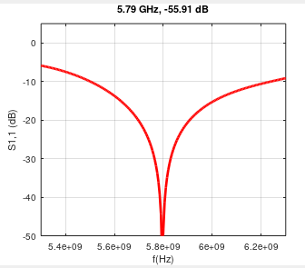

Since there are now two independent patch elements, each of them could operate in different modes (e.g. completely in- or out-of-phase), which could potentially introduce unwanted sidelobes, so the behaviour of the electric fields as well as the radiation pattern needs to be watched closely. The [OpenEMS](https://www.openems.de/) FEM simulation showed a well behaving antenna:

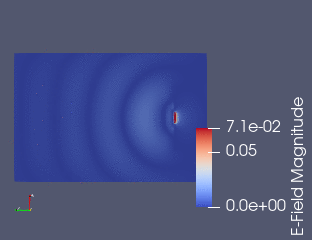  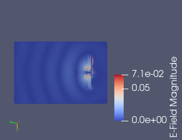

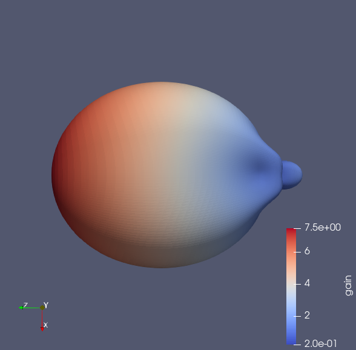  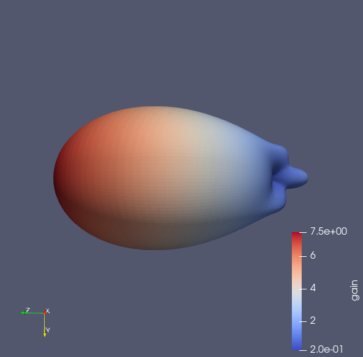

The actual manufactured antenna is made of two pieces (the active and the passive parts), bolted together using M3 nylon bolts and spacers.

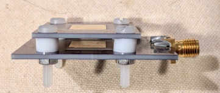

VNA measurement of the antenna confirms the expected broader bandwidth:

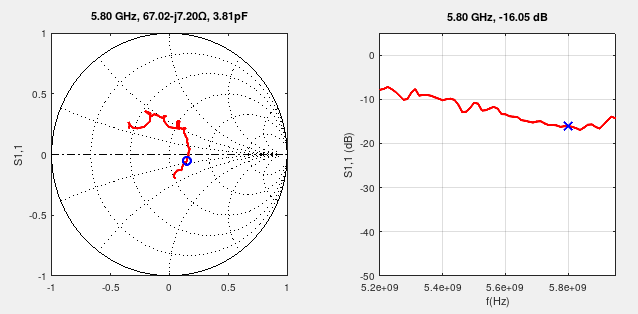

With slight modifications to the aperture size in the simulation I was able to get pretty much the exact same S11 reults as measured above with the VNA; This helps with aligning the simulation better with the actual manufactured PCB performance:

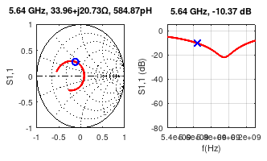

The radiation pattern was measured in a simple room setup using two identical antennas, one as Tx and one as Rx (the wavelength at 5.8 GHz is short enough so that just a short distance between the two antennas satisfies far-field measurement conditions while being able to keep reflective materials at sufficient distance)

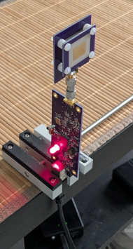  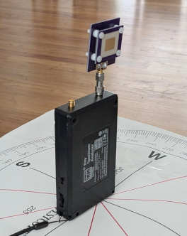

The transmitter is my [DIY 6 GHz signal generator](https://github.com/szoftveres/RF_instruments/tree/main/siggen), the receiver is a cheap TinySA Ultra. Results were plotted on a polar chart and revealed close match to the simulation:

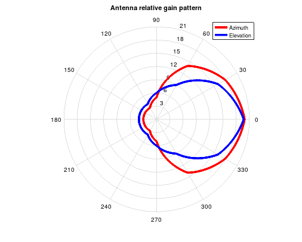

## Beamforming Array

A 2x2 beamforming array is technically just four identical antenna elements, placed at a given distance from each other, and fed in phase, to produce a narrow beam, and increase the gain due to the increased effective antenna aperture.

First, a 5.8 GHz microstrip combiner was designed for the 4-layer OSHpark PCB specs and simulated. Since the combiner is feeding identical antenna elements with identical signal, differential-mode termination can be ignored, allowing a simple λ/4 impedance transformer to be used instead of a more complex [Wilkinson-combiner](https://en.wikipedia.org/wiki/Wilkinson_power_divider).

The result of the design is broadband enough, allowing manufacturing tolerances:

[uSimmics](https://qucsstudio.de/) design:

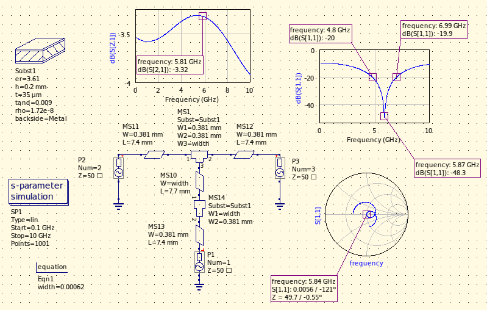

[OpenEMS](https://www.openems.de/) simulation:

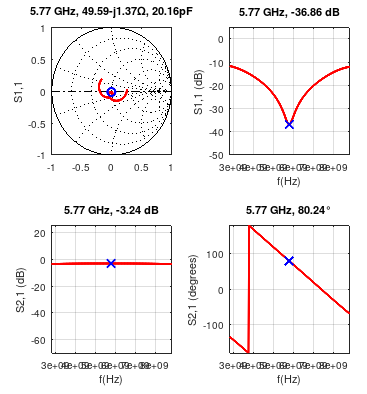

To get a clean 60° beam without sidelobes, the antenna elements must be placed λ/2 from each other. This close proximity however creates cross-coupling between the elements, meaning that the feedpoint impedance is not the same as of a single element any more (each element is picking up a signal from the adjacent element that is 180° out of phase).

The gain can be slightly increased and the beam can be slightly narrowed by increasing the distance between the elements, to about 3/4λ, at the expense of sidelobes appearing at 45°. Once the distance between the elements reaches 1 λ, the sidelobes grow just as big as the main lobe.

In this design, the elements are placed approximately 3/4λ (34mm) from each other.

Since the coupling aperture size allows adjustability of the feedpoint impedance of the individual elements, the strategy to deal with the inter-coupling between elements (and consequent impedance shift) was to adjust the aperture size until the array feedpoint impedance became 50Ω.

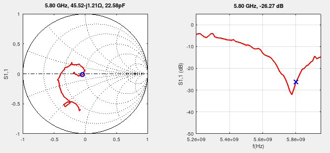

